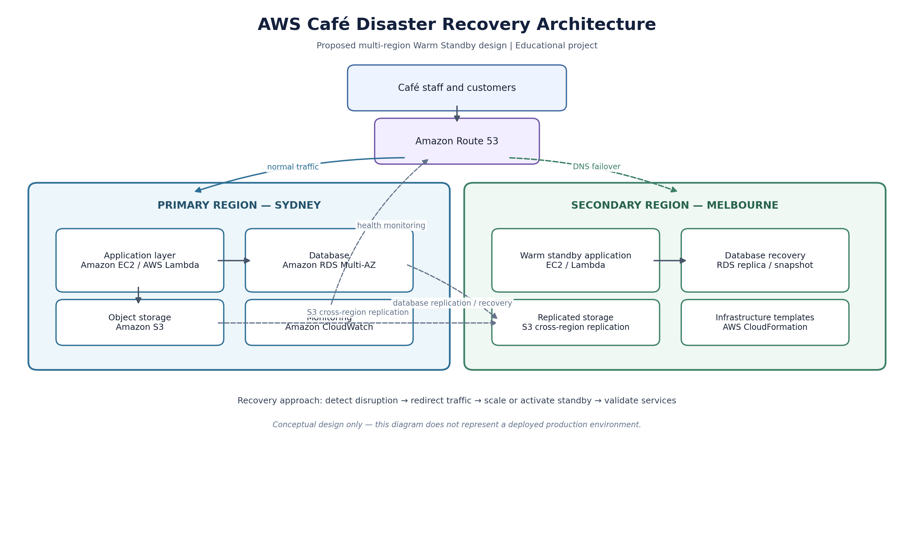

# AWS Café Disaster Recovery Architecture

## Project Overview

This project was completed as part of my TAFE NSW Cloud Architecture studies.

It focuses on designing a proposed AWS disaster recovery solution for a café business that relies on point-of-sale systems, customer records, inventory management and online ordering.

The objective was to improve business continuity, reduce downtime and protect business data during unexpected disruptions.

## Proposed Architecture

The solution uses a multi-region Warm Standby approach.

- **Primary Region:** Sydney (ap-southeast-2)
- **Secondary Region:** Melbourne (ap-southeast-4)

The proposed architecture includes backup, replication, monitoring and failover strategies.

## Architecture Diagram

View the full [AWS Disaster Recovery Architecture](architecture/architecture.md).

## AWS Services Considered

- Amazon EC2
- Amazon RDS Multi-AZ
- Amazon S3
- Amazon Route 53
- Amazon CloudWatch
- AWS IAM
- AWS CloudFormation
- AWS Lambda

## Recovery Objectives

| Business System | RTO | RPO |
|---|---|---|
| Point of Sale | 2 hours | 1 hour |
| Customer Database | 1 hour | 15 minutes |
| Inventory Management | 4 hours | 1 hour |
| Online Ordering | 2 hours | 30 minutes |

## Disaster Scenarios

- AWS regional outage
- Cyberattack or malware
- Application failure
- Data loss or corruption

## Skills Demonstrated

- AWS cloud architecture concepts
- Disaster recovery planning
- High availability and business continuity
- Backup and recovery strategies
- Risk assessment
- Technical documentation

## Architecture Diagram

## Project Documentation
- [View Project Details](project-details.md)

## Project Status

This is an educational architecture and disaster recovery planning project. The multi-region architecture is a proposed design, not a claim of a fully deployed production environment.
